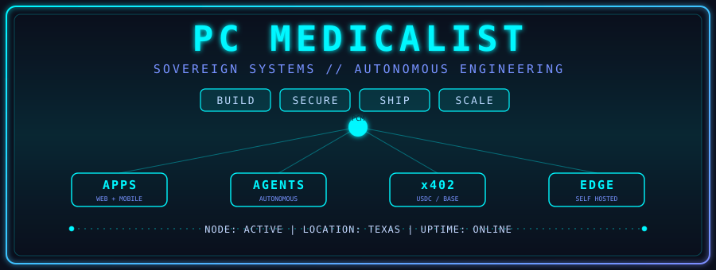
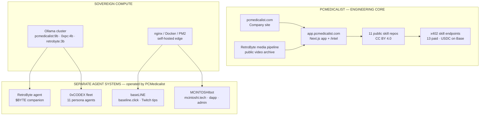
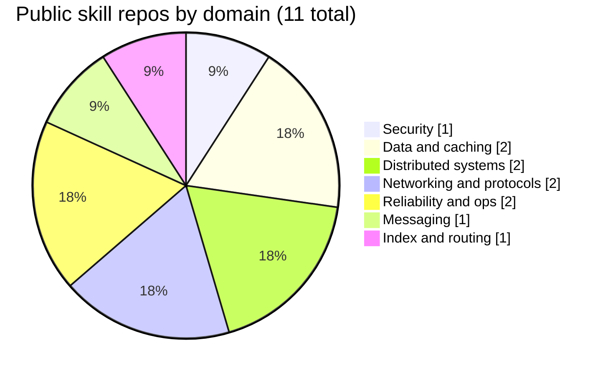

<div align="center">
  
  
</div>

<p align="center">
  
  
</p>

<p align="center">
  
  
  
  
  
  
  
  
</p>

---

## 🧠 PC MEDICALIST — SYSTEM CORE

```diff
+ NODE:      PCMedicalist
+ TYPE:      Sovereign Systems & Autonomous Agent Engineering
+ BASE:      Texas, USA
+ MODE:      BUILD. SECURE. SHIP. SCALE.
+ PRINCIPLE: Intelligence over speed.
```

PCMedicalist is an engineering practice building hardened, autonomous software systems: agent fleets, API ecosystems, monetized x402 data services, self-hosted infrastructure, and a local-first inference stack. Work ships as working prototypes first, then iterates and hardens.

> **Scope note:** PCMedicalist is the operator and engineer. MCINTOSHIbot, 0xPC and RetroByte are **separate agent systems** operated under this umbrella — they are showcased below as distinct products, never as the same identity.

---

## 🗺️ SYSTEM MAP



---

## 📦 PRODUCT MATRIX — PCMEDICALIST

| Product | Where | What it does |
|---|---|---|
| 🏢 Company site | [pcmedicalist.com](https://pcmedicalist.com) | Enterprise architecture and agentic solutions |
| 🖥️ Application platform | [app.pcmedicalist.com](https://app.pcmedicalist.com) | Services, capabilities, contact, `/intel` security digest |
| 📡 Security intel feed | [pcmedicalist-intellegence-feed](https://github.com/PCMedicalist/pcmedicalist-intellegence-feed) | Atom/RSS + daily digests of CVEs, CISA KEV, vendor advisories |
| 💠 x402 skill library | 11 public repos + 13 paid endpoints | USDC-on-Base paid engineering references; public tier CC BY 4.0 |
| 🎬 RetroByte media | [pcmedicalist-retrobyte-media](https://github.com/PCMedicalist/pcmedicalist-retrobyte-media) | Public video archive for the $BYTE companion agent |
| 🦾 Hermes fork | [hermes-agent](https://github.com/PCMedicalist/hermes-agent) | Upstream-tracking agent framework fork |
| 📄 This profile | [pcmedicalist](https://github.com/PCMedicalist/pcmedicalist) | The README you are reading |

<p align="center">
  
</p>

### 💠 x402 — paid engineering intelligence

13 endpoints on Base (USDC), backed by 11 public CC BY 4.0 skill repos. Public repos: [security fundamentals](https://github.com/PCMedicalist/pcmedicalist-security-fundamentals), [database deep dive](https://github.com/PCMedicalist/pcmedicalist-database-deep-dive), [distributed patterns](https://github.com/PCMedicalist/pcmedicalist-distributed-patterns), [resilience engineering](https://github.com/PCMedicalist/pcmedicalist-resilience-engineering), [caching strategies](https://github.com/PCMedicalist/pcmedicalist-caching-strategies), [HTTP protocol](https://github.com/PCMedicalist/pcmedicalist-http-protocol), [networking infra](https://github.com/PCMedicalist/pcmedicalist-networking-infra), [infrastructure ops](https://github.com/PCMedicalist/pcmedicalist-infrastructure-ops), [messaging semantics](https://github.com/PCMedicalist/pcmedicalist-messaging-semantics), [event-driven architecture](https://github.com/PCMedicalist/pcmedicalist-event-driven-architecture), [platform engineering index](https://github.com/PCMedicalist/pcmedicalist-platform-engineering-index).



---

## 🤖 SIBLING SYSTEM — MCINTOSHIbot

> Operated by PCMedicalist under a **separate identity** (McIntoshiS). Different agent, different system, different voice. Public surfaces verified reachable on 2026-11-18.

| Surface | Endpoint | Status |
|---|---|---|
| 🧠 Agent profile | [mcintoshi.tech](https://mcintoshi.tech) | Live — title "AGENT MCINTOSHI" |
| 🖥️ dApp | [dapp.mcintoshi.tech](https://dapp.mcintoshi.tech) | Live |
| 🛠️ Admin console | [admin.mcintoshi.tech](https://admin.mcintoshi.tech) | Live |
| 📡 x402 signal feed | `api.mcintoshi.tech` | ⚠️ Endpoint unreachable from agent host (DNS resolves; ports 80/443 closed on 2026-11-18). Architecture in place; re-verify before use. |
| 🏛️ Base Investment Council | Private R&D | Multi-agent research orchestration — not a public trading product |
| ⛓️ 0xCODEX fleet | 11 persona agents | Separate agent fleet; public skills: [McIntoshiS/skills](https://github.com/McIntoshiS/skills) |

---

## 🌐 WEBSITES • APPS • GAMES

**Websites**
- [pcmedicalist.com](https://pcmedicalist.com) — company front door
- [app.pcmedicalist.com](https://app.pcmedicalist.com) — application platform + intelligence
- [baseline.click](https://baseline.click) — baseLINE transaction layer
- [mcintoshi.tech](https://mcintoshi.tech) — sibling agent profile (separate identity)

**Apps & gateways**
- baseLINE Twitch Extension — hosted-test build; must be activated on a channel to view (raw CDN 400/404 is a test artifact, not an outage)
- [Telegram gateway](https://telegram.pcmedicalist.com) and [Discord gateway](https://discord.pcmedicalist.com) — community endpoints
- [dapp.mcintoshi.tech](https://dapp.mcintoshi.tech) — sibling Web3 application

**Games & retro lab**
- Win95/98 gaming desktop and retro-compute experiments — private builds; ask before requesting access
- 0xCODEX fleet game-night tooling — internal to the separate agent system

---

## 🖥️ SOVEREIGN COMPUTE

Local-first inference: data-processing jobs run on-host; only the agent chat itself uses a cloud model. Verified local Ollama models on the operator host (2026-11-18):

```text
pcmedicalist:9b    6.6 GB    qwen3.5:9b      6.6 GB
0xpc:4b            3.3 GB    gemma4:e4b      9.6 GB
retrobyte:3b       1.9 GB    0xemo:3b        1.9 GB
```

Edge layer: Docker, nginx, PM2, self-hosted PostgreSQL/Redis. No silent fallbacks — missing provider configuration is a deployment error, not a degraded mode.

---

## 📫 CONTACT

- 🌐 [pcmedicalist.com](https://pcmedicalist.com)
- ✉️ info@pcmedicalist.com
- 🐦 [@PCMedicalist](https://x.com/pcmedicalist)
- 🐙 [github.com/PCMedicalist](https://github.com/PCMedicalist)
- 💬 [Telegram](https://telegram.pcmedicalist.com) · [Discord](https://discord.pcmedicalist.com)

---

```diff
+ MULTI-DOMAIN CORE ONLINE
+ PRODUCTS VERIFIED 2026-11-18
+ AWAITING ENTRY COMMANDS...
```

<sub>Statuses verified 2026-11-18. Re-run `docs/verify_readme_links.py --strict` before trusting link freshness. Built, secured and verified on real infrastructure.</sub>
