<p align="center">
  
</p>

<p align="center">
  
</p>

---

## 🧠 SYSTEM CORE

```diff
+ NODE ID: PCMedicalist
+ TYPE: Autonomous Systems & Infrastructure Engineering
+ CORE: Python / TypeScript / Node.js / React
+ STATUS: ACTIVE [DIAGNOSE. SECURE. SCALE.]
```

> **Notice:** You are connected to a high-performance sovereign engineering node. 

PCMedicalist specializes in translating complex processes into hardened, automated software architectures, focusing heavily on custom AI agent development, enterprise workflow scaling, and secure local environments.

---

## 📡 LIVE TELEMETRY

```yaml
core_infrastructure: operational
agent_workflows: continuous
data_integrity: verified
cryptographic_layer: initializing
operational_status: scaling
```

<p align="center">
  
</p>

<p align="center">
  
</p>

---

## ⚙️ SYSTEM MODULES

<details>
<summary>🤖 AUTONOMOUS AGENT SYSTEMS</summary>

* Custom AI Agents & LLM Orchestration Pipelines
* Multi-Agent Consensus Frameworks & Persistent Memory
* Recurring Task & Data Intake Automation
* Event-Driven Microservices

</details>

<details>
<summary>🔒 HARDENING & DIAGNOSTICS</summary>

* Security-First Local AI Model Configurations (Private Inference)
* System Optimization, Access Boundaries & Input Validation
* Transaction Monitoring & Token/Wallet Authentications
* Ransomware Resiliency & Infrastructure Posture Hardening

</details>

<details>
<summary>🖥️ INFRASTRUCTURE & SYSTEMS</summary>

* Custom High-Performance Bare-Metal Engineering
* Thermal Engineering & Compute Cluster Optimization
* Virtualization, Linux/Apache Administration & Workstation Design
* High-Throughput Media Streaming & Routing Architectures

</details>

<details>
<summary>🌐 DIGITAL DEPLOYMENTS</summary>

* Production-Ready Full-Stack Applications (React / Next.js / Node.js)
* Scalable APIs & Core Web Protocols
* Containerized Microservices via Docker & Cloud Orchestration
* End-to-End Operational Growth Systems

</details>

---

## 🧰 CORE TECH STACK

<p align="center">
  
  
  
  
  
</p>

---

## 🧪 EXPERIMENTAL LAB

<details>
<summary>⚠️ DEPLOYMENT PIPELINES IN PROGRESS</summary>

* **Sovereign Local Inference:** Decoupling third-party API dependencies using heavily optimized open-source weights.
* **Cryptographic Automation:** Real-time wallet tracking hooks and atomic asset validation loops.
* **Continuous Monitoring Nodes:** Autonomous self-healing runtime containers checking network transport metrics.

</details>

---

## 🐍 ACTIVITY STREAM

<p align="center">
  
</p>

---

## 🌐 NETWORK ACCESS

```ini
[PRIMARY CORE]
https://pcmedicalist.com

[EMAIL TARGET]
pcmedicalist@gmail.com

[BROADCAST STATION]
Twitch.tv/PCMedicalist

[SECURE COMMS]
https://discord.pcmedicalist.com
```

---

## ⚡ FINAL STATUS

```diff
+ SYSTEM ONLINE
+ ASSETS VERIFIED
+ AWAITING INCOMING DEPLOYMENT COMMANDS
```

---

## ⚡ FINAL STATUS

```diff
+ SYSTEM ONLINE
+ READY FOR DEPLOYMENT
+ AWAITING NEXT COMMAND
```
