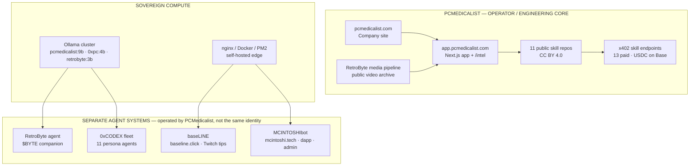
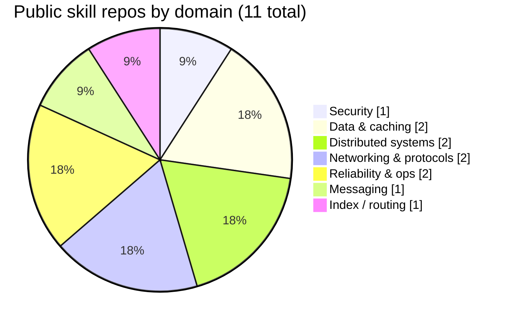

# PCMedicalist Profile README — Redesign Implementation Plan

> **For Hermes:** implement task-by-task using subagent-driven-development (spec review → code-quality review), then verify with real curl/render output. No commits or pushes without an explicit operator GO.

**Goal:** Replace the current broken profile README with a polished, verifiable "mission control" README that showcases PCMedicalist products, the separate MCINTOSHIbot system, live websites/apps, the local inference fleet, and the retro/game lab — using charts and graphics that actually render on GitHub.

**Architecture:** Static `README.md` on the public `PCMedicalist/pcmedicalist` default branch, with one local `assets/hero.svg` (self-contained, no external host), native GitHub Mermaid diagrams for the system map and taxonomy pie chart, and only verified third-party badge endpoints (github-readme-stats, shields.io, readme-typing-svg). A local verification script re-checks every external URL before publishing. Nothing private, no wallet keys, no dead links, no fabricated "live" claims.

**Tech Stack:** GitHub Flavored Markdown, Mermaid (flowchart + pie), inline SVG, github-readme-stats, shields.io, readme-typing-svg, Python 3 stdlib link checker, curl.

---

## Verified fact base (collected 2026-11-18 — do not re-litigate, re-verify only if a claim changes)

| Fact | Evidence |
|---|---|
| Profile: `PCMedicalist`, name "PC Medicalist", company "PCMedicalist", blog `https://pcmedicalist.com`, email `info@pcmedicalist.com`, X `@PCMedicalist`, Texas | GitHub API `/users/PCMedicalist` |
| 15 public repos: profile repo + `hermes-agent` fork + **11 skill repos** + `pcmedicalist-intellegence-feed` + `pcmedicalist-retrobyte-media` | GitHub API `/users/PCMedicalist/repos` |
| 13 paid x402 endpoints = 11 individual skills + `discovery` ($0.01) + `skills-pro` bundle ($4.00); USDC on Base | `pcmedicalist-skills-x402/bankr.x402.json`, `DEPLOY_RUNBOOK.md` |
| Live 200: `pcmedicalist.com`, `app.pcmedicalist.com`, `mcintoshi.tech` (title "AGENT MCINTOSHI"), `dapp.mcintoshi.tech`, `admin.mcintoshi.tech`, `baseline.click`, `telegram.pcmedicalist.com`, `discord.pcmedicalist.com` | `curl -L -w '%{http_code}'` |
| **DEAD: `api.mcintoshi.tech`** — DNS → `98.97.23.8`, ports 80/443 CLOSED, curl `000` | `getent hosts` + `/dev/tcp` probe + curl |
| Working badge endpoints: `readme-typing-svg.herokuapp.com`, `github-readme-stats.vercel.app/api`, `/api/top-langs/`, `/api/pin/`, `img.shields.io/badge/...`, `snyk.io/test/github/.../badge.svg` | all returned `200 image/svg+xml` |
| Broken (do NOT use): bare `herokuapp.com` (000), `vercel.app` (308), `demolab.com`/`shields.io`/`github.com` homepages (text/html), `github-profile-trophy.vercel.app` (402) | curl status + content-type |
| Charts: `quickchart.io` and `image-charts.com` both 200 image/png — available but **Mermaid preferred** (native, no external dependency) | curl |
| Local Ollama models (20): `pcmedicalist:9b` 6.6 GB, `retrobyte:3b` 1.9 GB, `0xpc:4b` 3.3 GB, `0xemo:3b`, `gemma4:e4b` 9.6 GB, etc. | `curl http://localhost:11434/api/tags` |
| `hud.svg` and `hub.svg` are byte-identical (md5 `472edf296b9095b78ea91583e15d0501`); sparse placeholder (title + 2 lines + 3 dashes + 1 circle) | md5sum + Chrome headless render → PNG + vision check |
| Council is real but PRIVATE: `pcmedicalist-mcintoshibot/src/council`, `docs/COUNCIL_ORCHESTRATOR_SPEC.md`, `tests/test_council_*` | host filesystem; local `base-investment-council/` has only `__pycache__` |
| Win95/game assets are PRIVATE (`pcmedicalist-win95`, `Win95-98-Gaming-Desktop`) | GitHub API `/user/repos` |
| README.md exists on `origin/main` only; absent on checked-out `x402-skills`; `.gitignore` untracked here | `git ls-tree`, `git status` |

**Identity rule (non-negotiable):** PCMedicalist = this agent/operator. MCINTOSHIbot, MCINTOSHI, 0xPC and RetroByte = SEPARATE agent identities, owned/operated by PCMedicalist but never impersonated. Every Mermaid node and paragraph must label them as distinct systems. Never write "I am MCINTOSHI" or merge their voice into PCMedicalist copy.

---

## Phase 0 — Branch & baseline

### Task 0.1: Create a clean authoring branch off the canonical main

**Objective:** Author the README where it actually lives, without dragging 35 unrelated `x402-skills` commits into the profile repo.

**Files:** `README.md`, `assets/hero.svg` (new), `docs/plans/2026-11-18-profile-readme-redesign.md` (this plan)

**Step 1:** Confirm state:
```bash
cd /home/pcmedicalist/pcmedicalist
git status --short --branch
git log -1 --oneline origin/main
git ls-tree --name-only origin/main
```
Expected: `README.md`, `hub.svg`, `hud.svg` in `origin/main`; current branch `x402-skills` has no root README.

**Step 2:** Create the work branch (no push):
```bash
git fetch origin main
git switch -c docs/profile-readme-redesign --track origin/main
```
Expected: `README.md`, `hub.svg`, `hud.svg` present in working tree. If checkout fails due to untracked-file collision, do NOT force — stop and report.

**Step 3:** Keep a copy of the old README for rollback:
```bash
mkdir -p docs/archive
cp README.md docs/archive/README.pre-redesign-2026-11-18.md
```

---

## Phase 1 — Graphics that render on GitHub

### Task 1.1: Build the hero SVG (replaces both `hud.svg` and `hub.svg`)

**Objective:** One self-contained, high-impact banner that looks complete even if GitHub strips SMIL animation.

**Files:** Create `assets/hero.svg`; modify `README.md` hero `` src.

**Step 1:** Write the SVG. Design spec: viewBox `0 0 900 340`; background `#0a0f1c`; frame stroke `#00f7ff` with glow filter; centered title `PC MEDICALIST` (font-size 44), subtitle `SOVEREIGN SYSTEMS // AUTONOMOUS ENGINEERING` (16); four status pills `BUILD` `SECURE` `SHIP` `SCALE`; four orbit nodes labeled `APPS`, `AGENTS`, `x402`, `EDGE`; bottom status line `NODE: ACTIVE | LOCATION: TEXAS | UPTIME: ONLINE`; static scanline gradient overlay; SMIL pulse only as enhancement.

**Step 2:** Render locally and look at it:
```bash
mkdir -p /tmp/pcm-hero-check
cp assets/hero.svg /tmp/pcm-hero-check/hero.svg
google-chrome --headless=new --no-sandbox --disable-gpu --hide-scrollbars \
  --window-size=900,340 --screenshot=/tmp/pcm-hero-check/hero.png \
  file:///tmp/pcm-hero-check/hero.svg
```
Then `vision_analyze` the PNG: assert no clipped text, no overlap, all four nodes visible, center not empty. This is a **visual** check, not just an XML parse.

**Step 3:** Delete the duplicated dead SVGs only after the hero renders:
```bash
git rm hud.svg hub.svg
```
(Skip this step if operator wants them retained as archives.)

### Task 1.2: Wire verified dynamic badges

**Objective:** Replace all 9 broken image URLs with endpoints that return real SVG.

**Files:** Modify `README.md`.

**Step 1:** Use exactly these verified src values (all probed 200 `image/svg+xml`):

| Slot | src |
|---|---|
| Typing header | `https://readme-typing-svg.herokuapp.com/?font=Fira%20Code&size=22&center=true&width=760&height=48&duration=3500&lines=PCMedicalist%3BSovereign%20Systems%3BAutonomous%20Engineering%3BShip%20Secure%20Software` |
| GitHub stats | `https://github-readme-stats.vercel.app/api?username=PCMedicalist&show_icons=true&theme=tokyonight&hide_border=true&title_color=00f7ff&icon_color=7c8cff&text_color=c9d6ff&bg_color=0a0f1c` |
| Languages | `https://github-readme-stats.vercel.app/api/top-langs/?username=PCMedicalist&layout=compact&theme=tokyonight&hide_border=true&langs_count=8` |
| Repo pin | `https://github-readme-stats.vercel.app/api/pin/?username=PCMedicalist&repo=pcmedicalist&theme=tokyonight&hide_border=true` |
| Stack badges | `https://img.shields.io/badge/Python-3776AB?style=for-the-badge&logo=python&logoColor=white`, same pattern for TypeScript/Next.js/Docker/Linux/Postgres/Redis |
| Vuln badge | `https://snyk.io/test/github/PCMedicalist/pcmedicalist/badge.svg` |

**Step 2:** Verify the exact encoded URLs (not just the base domains):
```bash
python3 docs/verify_readme_links.py --strict
```
Expected: exit 0, every URL `200` with an image/* content type where used in ``.

---

## Phase 2 — Charts (native Mermaid, no external chart host)

### Task 2.1: System map with the identity boundary

**Objective:** Show the whole ecosystem in one glance, with MCINTOSHIbot fenced as a separate agent system.

**Files:** Modify `README.md` (fenced `mermaid` block).

**Step 1:** Insert:



**Step 2:** Syntax check by rendering the README on GitHub (or locally with `npx @mermaid-js/mermaid-cli` if available). Assert: 3 subgraphs visible, no label containing a raw `:` break, no invented edges (every arrow must map to a verified relationship above).

### Task 2.2: Public skill taxonomy pie

**Objective:** A real chart from the 11 public repos — not decorative numbers.

**Files:** Modify `README.md`.

**Step 1:** Insert:


Mapping: security-fundamentals=1; database-deep-dive+caching-strategies=2; distributed-patterns+event-driven-architecture=2; http-protocol+networking-infra=2; resilience-engineering+infrastructure-ops=2; messaging-semantics=1; platform-engineering-index=1. Sum = 11.

**Step 2:** Verify sum with code, not mentally:
```bash
python3 - <<'PY'
vals = [1,2,2,2,2,1,1]
assert sum(vals) == 11, sum(vals)
print("pie total OK:", sum(vals))
PY
```

### Task 2.3: (Optional) Deployment status ribbon

**Objective:** Show live/dead honestly with shields, not a fabricated uptime widget.

**Step 1:** Use static badges only where verified: `https://img.shields.io/badge/pcmedicalist.com-200-2ea043`, `https://img.shields.io/badge/api.mcintoshi.tech-unreachable-critical`. Do not add a "99.9% uptime" badge — no metric backs it.

---

## Phase 3 — Content: projects, sites, apps, games

### Task 3.1: Product matrix for PCMedicalist

**Objective:** Give each product one card with endpoint, what it does, and an honest status.

**Files:** Modify `README.md`.

**Step 1:** Table with these rows (all links already curl-verified 200 except where marked):

| Product | Link | One-line value |
|---|---|---|
| Company site | https://pcmedicalist.com | Enterprise architecture & agentic solutions |
| Application platform | https://app.pcmedicalist.com | Services, capabilities, `/intel` security digest, contact |
| Security intel feed | https://github.com/PCMedicalist/pcmedicalist-intellegence-feed | Atom/RSS + daily digests of CVEs, KEV, vendor advisories |
| x402 skill library | 13 endpoints, linked to the 11 public skill repos | USDC/Base paid engineering references, CC BY 4.0 public tier |
| RetroByte media | https://github.com/PCMedicalist/pcmedicalist-retrobyte-media | Public video archive for the $BYTE companion agent |
| Hermes fork | https://github.com/PCMedicalist/hermes-agent | Upstream-tracking fork |
| Profile repo | https://github.com/PCMedicalist/pcmedicalist | This README |

**Step 2:** Never link private repos (`pcmedicalist-app`, `pcmedicalist-baseline`, `hermes-private`, `0xPCMedicalist`, etc.). If a product's repo is private, link its public endpoint instead.

### Task 3.2: MCINTOSHIbot system section (separate identity)

**Objective:** Showcase the sibling system without conflating identities or claiming a dead endpoint is live.

**Files:** Modify `README.md`.

**Step 1:** Copy that leads with attribution: "Operated by PCMedicalist under a **separate agent identity** (McIntoshiS). This is a different system, not the PCMedicalist agent."

**Step 2:** Cards:
- `mcintoshi.tech` — agent profile (verified 200, title "AGENT MCINTOSHI")
- `dapp.mcintoshi.tech` — dApp (verified 200)
- `admin.mcintoshi.tech` — ops console (verified 200)
- x402 USDC-gated signal feed — **status: endpoint unreachable from agent host on 2026-11-18** (`api.mcintoshi.tech` DNS resolves but 80/443 closed). Present as "architecture: in place; endpoint requires verification", with no clickable "LIVE" badge until curl succeeds.
- Base Investment Council — describe as private R&D (`src/council`, orchestrator spec, tests); no "live trading" claim.
- 0xCODEX fleet — 11 persona agents, separate identity; link only to public `McIntoshiS/skills` if desired.

**Step 3:** Add a note: "Statuses verified 2026-11-18; re-run `docs/verify_readme_links.py` before trusting them."

### Task 3.3: Websites / apps / games lab

**Objective:** Cover the "sites, apps and games" ask with honest labels.

**Files:** Modify `README.md`.

**Step 1:** Add three compact columns:

- **Websites:** pcmedicalist.com, app.pcmedicalist.com, mcintoshi.tech + dapp/admin, baseline.click.
- **Apps:** baseLINE Twitch extension (hosted test — must be activated on a channel; raw CDN 400/404 is a test artifact), Telegram/Discord community gateways, `dapp.mcintoshi.tech`.
- **Games & retro compute:** Win95/98 gaming desktop and retro compute experiments (private repos — label `internal / not public`), plus the 0xCODEX persona fleet's game-night culture. Ask operator which game title, if any, may be named publicly; until confirmed, use generic "Retro & Games Lab — private builds" with no dead links.

**Step 2:** Do not link `telegram.pcmedicalist.com` or `discord.pcmedicalist.com` as "live community" unless a member count / reachability check passes at publish time (both returned 200 on 2026-11-18, so they are safe to link).

### Task 3.4: Local inference section

**Objective:** Substantiate the "sovereign compute" claim with real model names.

**Files:** Modify `README.md`.

**Step 1:** List only verified models from `ollama /api/tags`: `pcmedicalist:9b` (6.6 GB), `0xpc:4b` (3.3 GB), `retrobyte:3b` (1.9 GB), `0xemo:3b`, `gemma4:e4b` (9.6 GB), `qwen3.5:9b`. Phrase: "Local-first inference — data-processing jobs run on-host; only agent chat uses a cloud model."

**Step 2:** Include a one-line terminal block showing `ollama list` output excerpt — real output only, no invented numbers.

### Task 3.5: Contact & footer

**Objective:** One consistent identity and contact set.

**Files:** Modify `README.md`.

**Step 1:** Replace `pcmedicalist@gmail.com` with `info@pcmedicalist.com` (matches GitHub profile). Add X `@PCMedicalist`, GitHub `PCMedicalist`, site, Telegram/Discord gateway links.

**Step 2:** Footer line: `PCMedicalist • Sovereign Systems • Built, secured and verified on real infrastructure`. Keep blue/cyan palette; reserve red strictly for genuine threat alerts (brand rule).

---

## Phase 4 — Verification & safety gates

### Task 4.1: Link + badge checker

**Objective:** Automate "did I publish a dead link?" — the exact failure mode of the current README.

**Files:** Create `docs/verify_readme_links.py`.

**Step 1:** Full implementation:

```python
#!/usr/bin/env python3
"""Verify every external URL in README.md. Usage: python3 docs/verify_readme_links.py [--strict]"""
import re, subprocess, sys, urllib.parse
from pathlib import Path

ROOT = Path(__file__).resolve().parents[1]
TEXT = (ROOT / "README.md").read_text(encoding="utf-8")

URLS = set(re.findall(r'(?:src="|href=|\]\()([^"\s)]+?)(?:"|\))', TEXT))
SKIP_PREFIXES = ("#", "mailto:", "./", "../", "assets/")

def check(url: str) -> tuple[str, int, str]:
    if any(url.startswith(p) for p in SKIP_PREFIXES):
        return url, 0, "skip"
    if url.startswith(("http://", "https://")) is False:
        return url, 0, "not-url"
    proc = subprocess.run(
        ["curl", "-s", "-L", "-o", "/dev/null", "-m", "20", "-w", "%{http_code} %{content_type}", url],
        capture_output=True, text=True,
    )
    parts = proc.stdout.strip().split(" ", 1)
    return url, int(parts[0]) if parts and parts[0].isdigit() else 0, (parts[1] if len(parts) > 1 else "")

def main() -> int:
    strict = "--strict" in sys.argv
    bad = []
    for url in sorted(URLS):
        u, code, ctype = check(url)
        status = "OK " if code == 200 else ("SKIP" if code == 0 else "BAD ")
        print(f"{status} {code} {ctype[:28]:28} {u[:110]}")
        if strict and code not in (0, 200):
            bad.append((u, code))
    if bad:
        print(f"\nFAIL: {len(bad)} non-200 URL(s) in strict mode")
        return 1
    print(f"\nPASS: {len(URLS)} URL(s) checked")
    return 0

if __name__ == "__main__":
    sys.exit(main())
```

**Step 2:** Run it and require PASS:
```bash
python3 docs/verify_readme_links.py --strict
```
Expected: `PASS: N URL(s) checked`, no `BAD` lines. Known exception: if an x402 endpoint intentionally returns 402/404, exclude it from README links entirely rather than allowlisting.

### Task 4.2: Secret and private-repo scan

**Objective:** Never leak keys, wallet addresses, or private repo paths onto a public profile.

**Files:** `README.md`.

**Step 1:**
```bash
python3 - <<'PY'
import re
from pathlib import Path
t = Path("README.md").read_text()
bad = re.findall(r'(0x[a-fA-F0-9]{40}|ghp_[A-Za-z0-9]{20,}|sk-[A-Za-z0-9]{20,}|-----BEGIN|password\s*=|/home/pcmedicalist)', t)
print("SECRET-LIKE MATCHES:", bad)
assert not bad, bad
PY
```
Expected: `SECRET-LIKE MATCHES: []`.

### Task 4.3: Render check, not just parse check

**Objective:** Confirm GitHub-flavored rendering — especially Mermaid and the SVG.

**Files:** `README.md`, `assets/hero.svg`.

**Step 1:** Check Mermaid blocks are balanced:
```bash
python3 - <<'PY'
from pathlib import Path
t = Path("README.md").read_text()
print("mermaid fences:", t.count("```mermaid"), "| total fences:", t.count("```"))
assert t.count("```") % 2 == 0
PY
```

**Step 2:** Produce a local HTML preview with Mermaid from CDN and screenshot it in headless Chrome; inspect the PNG with vision. Assert the flowchart's 3 subgraphs and the pie chart both render and no label overflows.

**Step 3:** Re-run the hero SVG visual check from Task 1.1 on the final asset.

### Task 4.4: Final diff review

**Step 1:**
```bash
git diff --stat
git diff -- README.md | head -200
git status --short
```
**Step 2:** Confirm: no `.env`, no `auth.json`, no private repo URLs, no invented uptime/live claims, all 4 `://` literals gone, contact email consistent, MCINTOSHIbot fenced as separate identity.

---

## Acceptance criteria (all must pass)

- [ ] `python3 docs/verify_readme_links.py --strict` → PASS, zero BAD URLs.
- [ ] Hero SVG visually inspected via rendered PNG: no clipping/overlap, not sparse.
- [ ] Mermaid system map renders with 3 labeled subgraphs; identity boundary explicit.
- [ ] Mermaid pie sums to exactly 11 (matches public repo count).
- [ ] Zero secret-like strings; zero private-repo links; zero `://` malformed URLs.
- [ ] Dead `api.mcintoshi.tech` is NOT presented as live/clickable.
- [ ] Games/retro section labels private builds as private; no dead links.
- [ ] Contact email is `info@pcmedicalist.com` everywhere.
- [ ] Diff reviewed on the `docs/profile-readme-redesign` branch; **no commit or push until operator says GO**.

## Out-of-scope / operator decisions needed

1. Exact public name for the retro game title (Win95 desktop repos are private).
2. Whether to publish an x402 endpoint URL once the Bankr routes are confirmed live (all probed 404 on 2026-11-18).
3. Repo metadata polish (topics, homepage, description, LICENSE) and history cleanup (1.39 GiB pack with ~600 MB of old backup archives) — propose as a separate task after README ships.
4. Whether to delete `hud.svg`/`hub.svg` or archive them.
